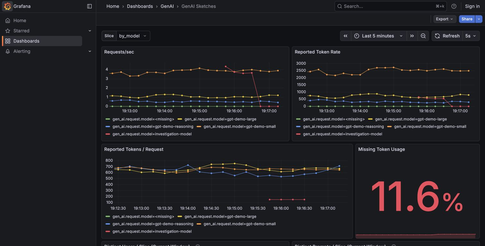

# otelcol-genai-sketches

[](https://github.com/llm-measurement/otelcol-genai-sketches/actions/workflows/ci.yml)
[](LICENSE)
[](https://scorecard.dev/viewer/?uri=github.com/llm-measurement/otelcol-genai-sketches)

`genaisketch` is an OpenTelemetry Collector connector and ready-to-run distribution.
It turns GenAI spans into token metrics, keyed rankings of users and sessions, and
summary files, while keeping user, session and prompt identities out of metric
labels. Your existing trace backend keeps receiving the original spans.

Use it to track LLM token usage by user, session and model, and to see where usage
data is missing, in Prometheus or any OTLP metrics backend.

| Status | |
| --- | --- |
| Stability | alpha: traces to metrics |
| Distributions | this repository's collector image and Helm chart; the connector module for custom builds |
| Issues | [open issues](https://github.com/llm-measurement/otelcol-genai-sketches/issues) |
| Code owners | @kwisatzh |

## Run it on your traffic

Choose the path matching your source; keep your existing trace backend.

- **[Standard GenAI spans](docs/SHADOW_MODE.md):** model-call spans using `gen_ai.operation.name` (or `gen_ai.request.model` when absent) and `gen_ai.usage.input_tokens` / `gen_ai.usage.output_tokens`; add `genaisketch` beside your existing trace exporter.
- **[LiteLLM](examples/integrations/litellm/README.md#connect-an-existing-proxy):** an existing proxy exporting model spans through its OpenTelemetry callback.
- **[agentgateway](examples/integrations/agentgateway/README.md#use-it-with-your-gateway):** model spans with token usage, a verified user identity and your application's session header.
- **[Envoy AI Gateway](examples/integrations/envoy-ai-gateway/README.md#mapping-your-traffic):** the standalone AI gateway's GenAI spans, with trusted user and session headers mapped to span attributes.
- **[Copilot CLI](examples/integrations/coding-agents/README.md#source-settings-and-mappings):** OpenTelemetry model spans with token usage and `gen_ai.conversation.id` for sessions.
- **[Copilot Chat](examples/integrations/coding-agents/README.md#source-settings-and-mappings):** OpenTelemetry model spans with token usage and `copilot_chat.session_id`, or resource `session.id`.
- **[OpenInference / OpenLLMetry](examples/integrations/genai-normalizer/README.md#put-it-in-your-pipeline):** vendor-shaped model spans, normalized on the sketch branch by a separate contrib collector before reaching v0.3.2.

The guides start with your own data: [check a trace capture](https://llm-measurement.github.io/traces-usage.html),
[review your collector configuration](https://llm-measurement.github.io/cardinality.html),
or [compare LiteLLM spend exports directly](https://llm-measurement.github.io/litellm-spend.html).

## Try It



*Synthetic demo traffic.*

You need Docker with Compose v2, Git, and a POSIX shell (macOS, Linux, or WSL).
The demo is synthetic and needs no model account or API key.

Clone the repository and start the stack:

```sh
git clone https://github.com/llm-measurement/otelcol-genai-sketches.git
cd otelcol-genai-sketches
sh examples/demo.sh up
```

You'll get a sample app, this collector, a Prometheus metrics server, and Grafana.
Open the dashboard printed by the command to see request rate, reported token
rate, distinct activity, and missing usage. The first build takes several minutes;
allow one minute after startup for the first measurement window.

[Watch the walkthrough](docs/media/README.md), or open the
[demo guide](examples/README.md) for top-k rankings, controlled investigations,
ports, secret handling, dashboard reading order, and cleanup. The [token-consumption playbook](docs/TOKEN_USAGE.md) gives
queries for investigating your own traffic, including unexpected "token maxing."

## Find Your Guide

| Your path | Start here | What you'll see |
| --- | --- | --- |
| Claude Code and Codex traces (TraceLab) | [Replay the recorded investigation](examples/tracelab/README.md) | Three sessions behind a 17% overnight token increase, checked against source totals |
| Kubernetes summary files and alerts | [Export and readback](docs/SUMMARY_EXPORT_HELM.md) / [alerts](docs/ALERTING.md) | Local `investigate` and `scan`, plus optional Prometheus alerts |
| Several teams or collectors | [Summary exchange](docs/SUMMARY_EXCHANGE.md) / [fleetdiff](https://github.com/llm-measurement/fleetdiff) | Combine compatible measurements and compare windows while each team keeps its backend |

## How It Works

```text
applications -> Collector fan-out -> current trace backend
                                  -> genaisketch -> Prometheus metrics
                                                -> keyed top-k snapshot logs
                                                -> optional summary files -> fleetdiff
```

Keep Datadog, Langfuse, Alloy, or another OTLP destination as your trace backend.
The connector counts model attempts separately from agent, tool, retrieval, and
MCP spans, and records missing token usage explicitly.
It uses [llm-sketchkit](https://github.com/llm-measurement/llm-sketchkit) to hash
configured identities, estimate distinct activity, and rank heavy contributors.
Compatible summary files let [fleetdiff](https://github.com/llm-measurement/fleetdiff)
compare windows across collectors without uploading raw traces.
Fan-out preserves the original traces, so disable content capture or redact
before fan-out when raw content must stay local.

Read [Shadow Mode](docs/SHADOW_MODE.md), [Accounting](docs/ACCOUNTING.md), [Metrics](docs/METRICS.md), [Configuration](docs/CONFIGURATION.md), and the [deployment FAQ](docs/FAQ.md#can-i-use-this-with-self-hosted-models-or-a-mix-of-providers) for fan-out, accounting rules, signals, and input fields.

## Install

For a persistent deployment, use the signed release image or Helm chart.
Follow [Deployment](docs/DEPLOYMENT.md) to verify signatures and attestations,
pin immutable digests, configure the hashing secret, and start the collector.

| Artifact | Released version | Reference |
| --- | --- | --- |
| Collector image | `v0.3.2` | `ghcr.io/llm-measurement/otelcol-genai-sketches` |
| Helm chart | `0.3.4` | `oci://ghcr.io/llm-measurement/charts/otelcol-genai-sketches` |

The image supports Linux amd64 and arm64. For Kubernetes, the deployment guide
includes the verified chart install and an existing-Secret configuration.

For a custom collector build, add the standalone module using the [component README](connector/genaisketchconnector/README.md#custom-collector-builds).
Read [Sizing](docs/SIZING.md) for capacity planning and
[Upgrading](docs/UPGRADING.md) for feature availability, restarts, and rollback.

## Privacy And Limits

- **Keyed hashes are pseudonymous.** Values are linkable under the same secret;
  secret holders can test candidate values. Restrict access to snapshots and
  summary files. Key rotation starts a new comparison period.
- **Slice labels are bounded and cleartext.** Choose non-sensitive dimensions
  such as model, team, or route. Excess slice values share an overflow bucket;
  user/session hashes and top-k items stay out of metric labels.
- **Estimates carry uncertainty.** Distinct counts are estimates; frequent-item
  rankings include lower and upper bounds. Use compatible summary state to
  combine measurements, rather than adding distinct-count gauges.
- **Use exact records for billing and quota enforcement.** Reported usage and
  coverage support investigation; optional Bloom deduplication can undercount.
  Keep provider records and an exact ledger for financial or admission decisions.

See [Security](SECURITY.md) for private vulnerability reporting and
[Accounting](docs/ACCOUNTING.md) for measurement semantics.

## Project

Evaluate with representative traffic; see the [changelog](CHANGELOG.md) and [release and support policy](SUPPORT.md) for pre-1.0 changes, signed artifacts, SBOMs, provenance, and upgrades.

The [benchmark report](docs/BENCHMARKS.md) records reproduction commands, workloads,
machine details, and all recorded accuracy, throughput, and soak runs.

[Contributing](CONTRIBUTING.md) covers development and signed, signed-off commits.
For questions or feedback, [open an issue](https://github.com/llm-measurement/otelcol-genai-sketches/issues/new/choose).

Licensed under the [Apache License 2.0](LICENSE).
